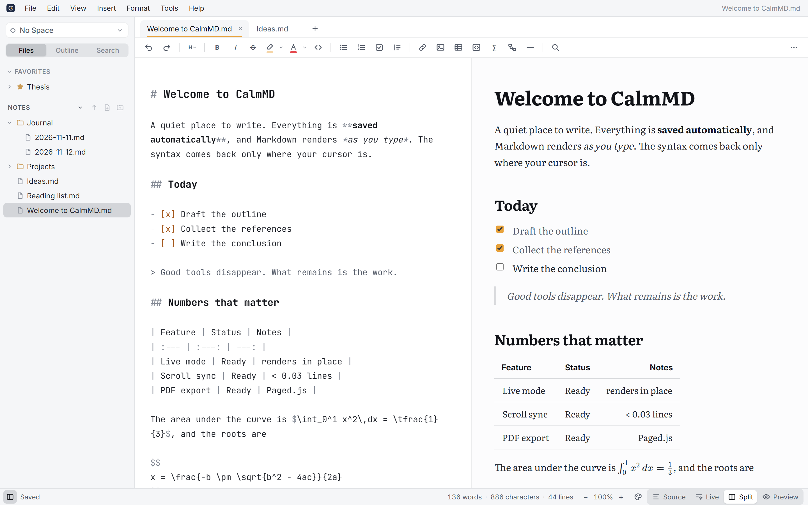
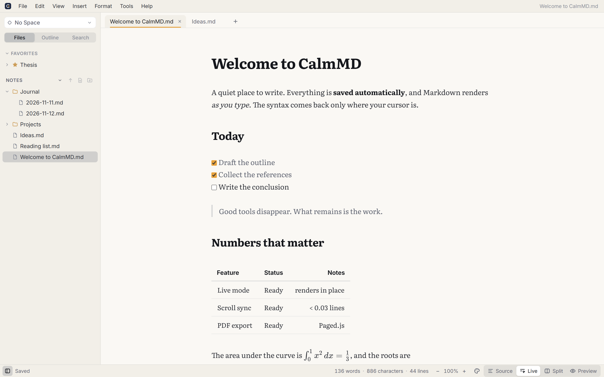
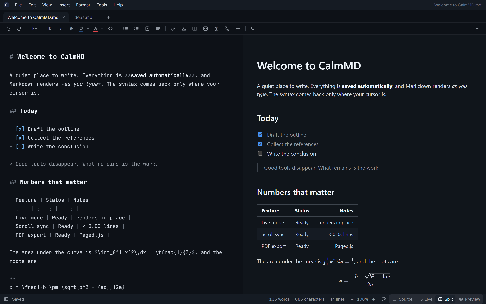
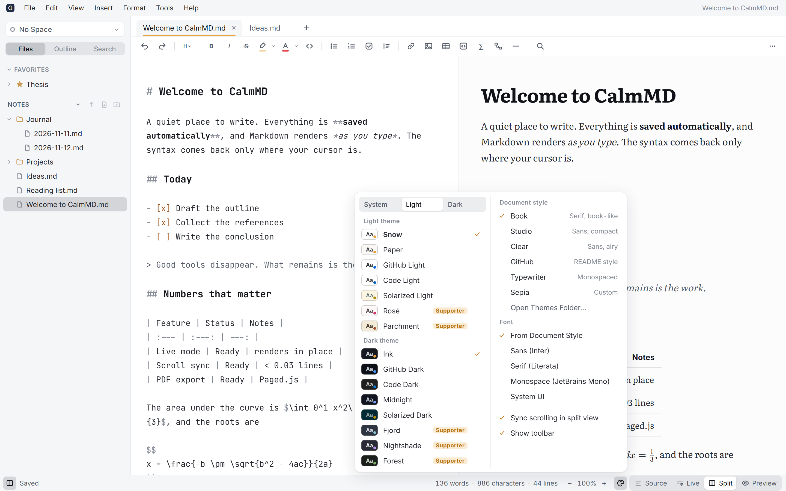
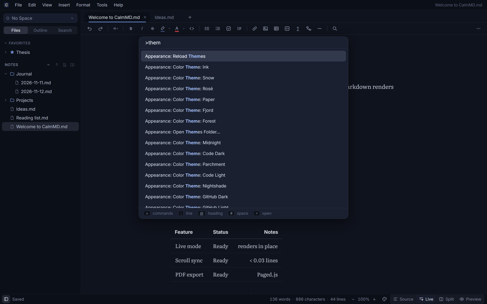

<p align="center">
  
</p>

<h1 align="center">CalmMD</h1>

<p align="center"><em>Markdown, calmly.</em><br>
A beautiful, open-source Markdown editor for macOS, Windows and Linux. It has power features and stays quiet.</p>

<p align="center">
  <a href="../../releases/latest">Download</a> ·
  <a href="#features">Features</a> ·
  <a href="#building-from-source">Build from source</a> ·
  <a href="CONTRIBUTING.md">Contribute</a>
</p>



## Why CalmMD

Most editors make you choose between *beautiful and simple* and *powerful and busy*. CalmMD keeps
the interface quiet but never hides anything. Every action is in the menus (File, Edit, View, Insert,
Format, Tools), and also in the toolbar, the command palette, the right-click menu, a small bubble when you
select text, and `/` commands.

- **Live mode** renders Markdown as you type. The syntax comes back only where your cursor is, and
  lines never jump when it does.
- **Split view with scroll sync that's actually accurate.** Every rendered block is mapped to its
  source lines and interpolated in between, so images, tables and code stay aligned in both directions.
- **PDFs worth sending.** Page numbers, running headers, a table of contents with real page numbers,
  and the same typography as the preview. No LaTeX install needed.
- **Your files, your folders.** Plain `.md` files on disk, saved automatically and safely. No account,
  no cloud, no telemetry.

## Features

| | |
|---|---|
| **Four views** | Source · Live · Split · Preview (`Ctrl/⌘+E` to cycle) |
| **Writing** | GFM tables, task lists, footnotes, `==highlight==`, sub/superscript, GitHub-style callouts, front matter, inline and block HTML, KaTeX math, Mermaid diagrams, syntax-highlighted code, video embeds |
| **Images** | Paste or drop images: they're saved in an `assets` folder next to the document (or in the folder root) and linked relatively, so the folder can be moved or shared |
| **Files** | File explorer with a folder switcher (recent folders, go up), favorites for files and folders, outline, tabs that come back after a restart |
| **Spaces** | Save a window (folder, tabs, layout, view mode) as a Space; switch from the top of the sidebar or with `Ctrl/⌘+Alt+O`; open Spaces in their own windows |
| **Finding things** | Command palette (`Ctrl/⌘+Shift+P`), go to file (`Ctrl/⌘+P`), line (`:`), heading (`@`) |
| **Editing help** | Adaptive right-click menus (links, images, code, tables), selection bubble, `/` block menu, table editing with auto-aligned columns |
| **Export** | PDF, standalone HTML (fonts and images embedded), Copy as HTML; Word/ODT/EPUB when [Pandoc](https://pandoc.org) is installed |
| **Looks** | Ten colour themes (Snow, Paper, GitHub Light and Dark, Code Light and Dark, Solarized Light and Dark, Ink, Midnight) with a separate light and dark choice for "Match system"; five document styles (Book, Studio, Clear, GitHub, Typewriter); your own CSS themes |
| **Safety** | Crash-safe atomic saves, drafts for untitled documents, never overwrites changes made by other apps |

<table>
<tr>
<td></td>
<td></td>
</tr>
<tr>
<td align="center"><sub>Live mode: the syntax appears only where you're typing</sub></td>
<td align="center"><sub>GitHub Dark with the GitHub document style</sub></td>
</tr>
<tr>
<td></td>
<td></td>
</tr>
<tr>
<td align="center"><sub>Colour themes and document styles</sub></td>
<td align="center"><sub>Everything is one command away</sub></td>
</tr>
</table>

### PDF export

PDFs are laid out with [Paged.js](https://pagedjs.org) and printed by a Chromium engine. On
**Windows** that's Microsoft Edge, which comes with Windows, so nothing to install. On macOS
and Linux, any installed Chrome, Edge, Chromium or Brave is used. Without one, CalmMD opens the
system print dialog ("Save as PDF") instead.

Options include page size, margins, a title header, page numbers, a table of contents, and starting each
chapter on a new page. Put `---pagebreak---` on its own line for a manual break. See
[`docs/samples`](docs/samples) for example output.

### Themes

Pick a colour theme and a document style from the palette icon in the status bar or from
**View → Color Theme / Document Style**. For your own, open **View → Document Style → Open Themes
Folder…** and drop in a `.css` file. A comment at the top names it and
picks the built-in style it starts from:

```css
/* @name Sepia
   @base paper */
:root { --preview-bg: #f5ecdc; }
.md-body { --fg: #46382a; --link: #9a4d12; }
```

Themes apply to the preview, Live mode and every export.

### Keyboard

`Ctrl` on Windows and Linux, `⌘` on macOS. **Help → Keyboard Shortcuts** (`F1`) lists them all.

| Action | Shortcut | Action | Shortcut |
|---|---|---|---|
| Command palette | `Mod+Shift+P` | Go to file | `Mod+P` |
| Cycle view mode | `Mod+E` | Sidebar | `Mod+\` |
| Bold / Italic / Link | `Mod+B` / `Mod+I` / `Mod+K` | Heading 1–6 | `Mod+Shift+1…6` |
| Toggle task | `Mod+Enter` | Switch Space | `Mod+Alt+O` |
| Highlight | `Mod+Shift+M` | All shortcuts | `F1` |

## Download

Get the latest build for your platform from [Releases](../../releases/latest):

- **Windows**: `.exe` installer (per-user, no admin rights needed) or `.msi`
- **macOS**: `.dmg` (Apple silicon and Intel)
- **Linux**: `.AppImage`, `.deb` or `.rpm`

> Builds are currently unsigned, so your OS may warn the first time you open CalmMD.

## Building from source

You need [Node.js](https://nodejs.org) 20+ and [Rust](https://rustup.rs) (stable), plus the
[Tauri prerequisites](https://tauri.app/start/prerequisites/) for your OS.

```sh
npm install
npm run app:dev     # the desktop app with hot reload
npm run app:build   # installers in src-tauri/target/release/bundle
```

`npm run dev` runs the editor in a browser (no Rust needed) against an in-memory file system. It's
handy for UI work. Add `?demo` to the URL for a showcase document.

## Privacy

CalmMD makes no network requests of its own: no telemetry, update pings or accounts. Remote images in
your documents load as you'd expect. Video embeds stay inert until you click them, and then use
YouTube's privacy-enhanced domain.

## Contributing

Contributions are welcome. Read [CONTRIBUTING.md](CONTRIBUTING.md) first. How the code fits together is in
[docs/ARCHITECTURE.md](docs/ARCHITECTURE.md), and product decisions are in [SPEC.md](SPEC.md).

## License

[MIT](LICENSE) © CalmMD contributors. Third-party components are listed in
[THIRD_PARTY_LICENSES.md](THIRD_PARTY_LICENSES.md).
