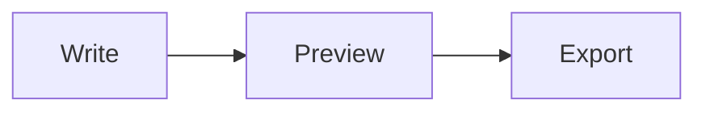

# Markdown guide

Everything here works in Live mode, the preview and every export. Switch to **Source**
(`Ctrl/Cmd+Alt+1`) to see the syntax behind it.

## Text

| You type | You get |
| --- | --- |
| `**bold**` | **bold** |
| `*italic*` or `_italic_` | *italic* |
| `~~strike~~` | ~~strike~~ |
| `==highlight==` | ==highlight== |
| `` `code` `` | `code` |
| `H~2~O`, `x^2^` | H~2~O, x^2^ |
| `<kbd>Ctrl</kbd>` | <kbd>Ctrl</kbd> |
| `\*not italic\*` | \*not italic\* |

## Headings

```
# Heading 1
## Heading 2
### Heading 3
```

## Lists and tasks

- Bullets start with `-`, `*` or `+`
  - Indent with Tab to nest
1. Numbers continue
2. when you press Enter

- [x] Tasks are bullets with `[ ]` or `[x]`
- [ ] Click the box to tick it

## Links and images

[Inline link](https://commonmark.org), [reference link][spec], and a bare URL: https://example.com


Paste a YouTube or Vimeo link on its own line to embed it.

[spec]: https://spec.commonmark.org

## Quotes and callouts

> A plain quote.
> > Quotes can nest.

> [!TIP]
> Start a quote with `[!NOTE]`, `[!TIP]`, `[!IMPORTANT]`, `[!WARNING]` or `[!CAUTION]`.

## Tables

| Left | Center | Right |
| :--- | :----: | ----: |
| a    |   b    |     c |

Right-click a table to add rows and columns, or use **Format → Table**.

## Code

```python
def greet(name):
    return f"Hello, {name}!"
```

## Math and diagrams

Inline math: $e^{i\pi} + 1 = 0$. Display math:

$$
\int_0^1 x^2\,dx = \frac{1}{3}
$$



## Footnotes

Add a footnote like this.[^1]

[^1]: The text appears at the end of the document.

## HTML

<details>
<summary>Click to expand</summary>

HTML blocks render too, with **Markdown** inside them.
</details>

---

Type `/` on an empty line for a menu of blocks, or press `Ctrl/Cmd+Shift+P` for every command.
